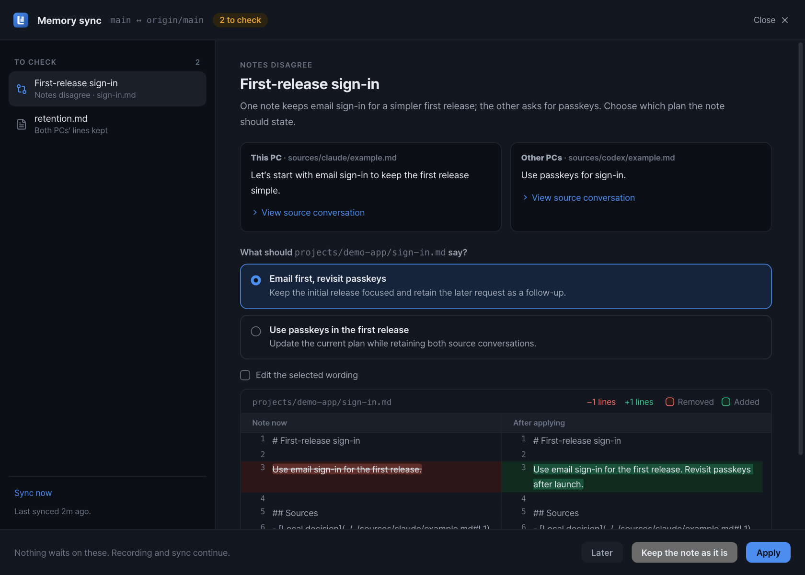
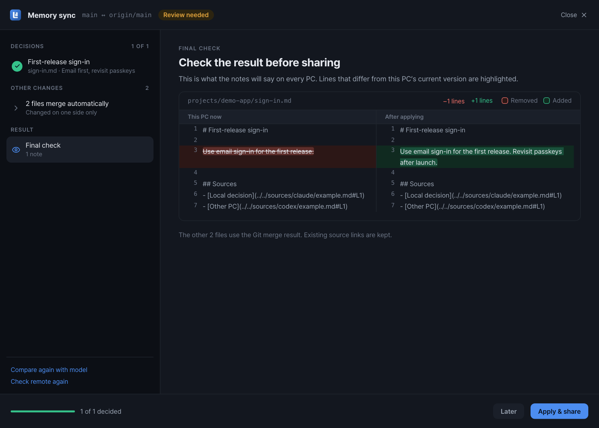

<div align="center">


# Lore — 코딩 에이전트를 위한 프로젝트 기억

**결정을 남기고, 이유를 기억하세요.**

Claude Code와 Codex의 대화에서 결정·이유·해결 경험을 기록합니다.<br />
Markdown으로 보관하고, qmd로 찾고, Git으로 다른 PC에서도 이어 씁니다.

[시작하기](#시작하기) · [여러 PC에서 공유](#여러-pc에서-공유) · [문서](#문서) · [English](README.md)




<sub>실제 구현 화면에 시험용 예제와 저장된 모델 응답을 표시했습니다. 현재 앱 UI는 한국어입니다.</sub>

</div>

## 왜 Lore인가요?

“코드가 뭘 하는가”보다 “왜 이렇게 만들었는가”를 찾는 데 시간이 더 들 때가 있습니다. 새 세션의 에이전트는 파일을 읽을 수 있지만, 이전에 포기한 방법이나 결정을 바꾼 이유까지 알기는 어렵습니다.

Lore는 프로젝트의 결정과 이유, 기억할 문제, 실패와 해결 경험을 **주제별 문서**로 남깁니다. 근거가 된 대화로 돌아갈 수 있고, 결정이 달라졌을 때도 이전 기록과 변경 이유를 함께 보존하는 것을 목표로 합니다.

## 주요 기능

- **작업하면서 기록** — Claude Code·Codex의 세션 종료와 압축 직전 훅으로 대화를 큐에 넣습니다. 트레이 앱이 마지막 기록 위치부터 이어서 처리합니다.
- **주제별 기억** — 선택한 기록 모델이 프로젝트·공통 문서를 갱신합니다. 세션마다 별도의 보고서를 쌓는 방식이 아닙니다.
- **확인할 수 있는 근거** — 기억 문서에서 저장된 대화 사본과 발언 앵커로 이동합니다. 상대 링크라 문서와 근거를 다른 PC로 함께 옮길 수 있습니다.
- **Markdown과 검색** — 선택한 폴더에 문서를 보관하고 [qmd](https://github.com/tobi/qmd)로 색인합니다. 후속 에이전트는 qmd MCP로 관련 기억을 검색할 수 있습니다.
- **검토 후 커밋** — 마지막 커밋과 현재 내용을 나란히 비교하고 커밋할 문서를 고릅니다. 대화의 기억 문서 반영은 자동이며, 이 검토는 Git 커밋을 결정하는 단계입니다.
- **여러 PC의 충돌 검토** — 양쪽 이력이 갈라지면 근거 대화와 선택지를 확인하고, 최종 문서를 미리 본 뒤 반영·공유합니다.
- **중단 후 복구** — 대기·실패 작업을 확인하고 다시 시도하거나 실패한 기록 구간을 넘길 수 있습니다. 동기화의 검색 갱신·전송 실패도 상태를 보존합니다.
- **트레이에서 제어** — 일시 중지, 모델·훅 설정, 라이트·다크 테마를 지원합니다.

## 동작 흐름

```text
Claude Code / Codex의 세션 종료 또는 압축 직전
  → 훅이 원문 경로를 로컬 큐에 등록
  → 모델이 프로젝트·공통 문서의 변경안을 작성
  → Lore가 경로·인용문·근거 링크·수정 위치를 검사
  → 기억 문서와 대화 사본 저장, qmd 색인 갱신
  → 다음 세션에서 qmd MCP로 관련 기억 조회
```

무엇을 기억할지는 모델이 판단합니다. 프로그램의 검사는 잘못된 형식과 유효하지 않은 수정을 걸러내지만, 기억의 정확성을 증명하지는 않습니다. 후속 에이전트에도 qmd MCP와 기억을 찾아보라는 지침이 필요합니다. 기록만 켠다고 모든 세션이 기억을 자동 활용하는 것은 아닙니다.

## 시작하기

현재 개발 중이며, 아래 방법으로 소스에서 빌드합니다.

### 필요한 것

- 로그인된 Codex 또는 Claude CLI: 기록 모델 실행에 사용합니다.
- 이 PC에서 실행 가능한 [qmd](https://github.com/tobi/qmd): 색인과 검색에 사용합니다.
- 동기화에는 Git 2.38 이상과 기억 저장소의 remote·현재 브랜치 upstream이 필요합니다.
- 소스 빌드에는 stable Rust, Node.js 24, pnpm과 운영체제별 [Tauri 2 사전 준비](https://v2.tauri.app/start/prerequisites/)가 필요합니다.

모델 호출은 선택한 CLI의 인증과 사용 한도를 사용하며 제공자의 과금이 발생할 수 있습니다. 처리에 필요한 대화와 기억 문서는 해당 모델 제공자에게 전달됩니다.

### 빌드와 실행

이 저장소를 체크아웃한 폴더에서 실행합니다.

```sh
pnpm install --frozen-lockfile
pnpm tauri dev                  # 개발용 실행, 화면 변경 시 새로고침
pnpm tauri build                # 현재 운영체제의 앱 패키지 빌드
```

훅 CLI는 빌드·패키징에 함께 포함됩니다. 제품 이름은 **Lore**로 정했으며, 현재 앱 번들·CLI·데이터 식별자는 기존 **`qmd-memory`**를 사용합니다. 아래 명령도 현재 실행 파일 이름을 기준으로 합니다. CLI가 셸 PATH에 자동 등록되지는 않으므로 필요하면 전체 경로로 실행합니다. macOS 번들에서는 `qmd-memory.app/Contents/MacOS/qmd-memory-cli`, Windows에서는 앱과 같은 폴더의 `qmd-memory-cli.exe`입니다.

### 기억 저장소 연결

1. 앱 설정에서 기억 저장소와 기록 CLI·모델을 지정합니다. 새 기억 저장소 기본 위치는 `~/Documents/knowledge`입니다.
2. 트레이 앱을 완전히 종료하고 포함된 CLI로 의존성과 색인을 확인합니다.

   ```sh
   qmd-memory-cli doctor
   qmd-memory-cli index
   ```

3. 기억을 읽을 코딩 도구에 qmd MCP를 연결합니다. `QMD_CONFIG_DIR`, `XDG_CACHE_HOME`, 색인 이름을 `doctor`가 보여 준 경로·값에 맞추고, 에이전트에게 필요할 때 프로젝트 기억을 검색하라는 지침을 줍니다.
4. 앱을 다시 켜고 **설정 → 훅 연결**에서 Claude Code 또는 Codex를 연결합니다. Codex에서는 필요한 경우 `/hooks`에서 새 훅을 신뢰로 표시합니다.
5. Git 프로젝트에서 작업한 세션이 종료되거나 압축되면 트레이에서 기록 결과를 확인합니다.

앱이 꺼져 있어도 훅은 큐에 등록하며, 앱을 다시 켜면 처리합니다. 훅이 실행되지 않은 세션은 자동으로 찾지 않습니다. 필요하면 `qmd-memory-cli scan`으로 직접 큐에 넣습니다.

기존 Windows 설치나 절대 경로 근거 링크를 옮길 때는 먼저 [이전 안내](docs/multiplatform.md#기존-windows-기억-가져오기)를 따릅니다.

## 여러 PC에서 공유

각 PC에 같은 **기억 Git 저장소**를 clone하고 앱에 그 PC의 경로를 지정합니다. 소스 프로젝트의 체크아웃 이름이 다르면 [고정 프로젝트 ID](docs/multiplatform.md#고정-프로젝트-id)를 사용합니다.

1. 로컬에서 기록된 문서를 검토하고 커밋합니다.
2. **동기화 → 공유 저장소 확인**으로 현재 브랜치의 upstream을 확인합니다.
3. 한쪽에만 새 커밋이 있으면 가져오기·전송과 이 PC의 검색 갱신을 처리합니다.
4. 양쪽 이력이 갈라지면 비교 자료를 준비합니다. 같은 프로젝트나 공통 기억의 변경은 Git 줄 충돌이 없어도 모델로 비교합니다.
5. 근거를 읽고 항목마다 선택한 뒤, 최종 문서 미리보기를 확인하고 반영합니다. 앱이 병합 커밋·검색 갱신·push를 처리하며 강제 push는 하지 않습니다.

**선택지를 고르면 처리할 수 있고, 문서를 직접 수정하는 것은 선택 사항입니다.** 5분마다 자동 동기화는 기본 꺼짐입니다. 켜면 커밋된 이력을 확인하고, 검토가 필요할 때 새 기억 기록을 대기시킵니다. 모델 비교와 최종 반영은 직접 진행합니다. 미커밋 문서를 자동 커밋하거나 stash하지 않습니다.

<details>
<summary>최종 문서 미리보기 화면</summary>



</details>

나중에 처리하기, 실패 후 재개, 지원하지 않는 충돌은 [동기화 검토 안내](docs/sync-review.md)에 설명했습니다. 모델이 의미 충돌을 놓칠 수 있으므로 근거와 최종 문구를 확인해야 합니다.

## 데이터와 공유 범위

```text
knowledge/
├── common/                  # 공통 기억
├── projects/<project-id>/   # 프로젝트별 기억
└── sources/<provider>/      # 근거 대화 사본
```

큐·설정·모델 실행 자료·qmd 색인은 PC별 앱 데이터에 두며 기억 폴더와 분리합니다. 새 근거 링크는 문서 기준 상대 경로와 원본 발언 앵커를 사용합니다.

Git으로는 **기억 저장소에 커밋한 모든 파일**이 공유됩니다. 대화 사본에는 인용한 문장 외의 내용도 들어 있을 수 있으므로 저장소의 공개 범위와 내용을 확인해야 합니다. 모델 처리에 필요한 대화와 문맥은 선택한 CLI의 제공자에게 전달됩니다. 전체 기능이 오프라인으로 동작하는 앱은 아닙니다.

## 플랫폼별 확인 상태

| 운영체제 | 빌드 구성 | 이 브랜치에서 확인한 범위 |
| --- | --- | --- |
| macOS | app / dmg | Apple Silicon app 빌드·격리 기동 확인. 서명·공증 미확인 |
| Windows | NSIS 설치본 | 플랫폼 코드와 CI 구성. 이번 브랜치의 Windows 실행 미확인 |
| Linux | deb / AppImage | 플랫폼 코드와 CI 구성. 실제 데스크톱 실행 미확인 |

개발은 Windows에서 시작했습니다. 현재 Mac 검증이 모든 운영체제의 훅·알림·데스크톱 연동을 검증했다는 뜻은 아닙니다. 자세한 결과와 한계는 [VALIDATION.md](VALIDATION.md)에 있습니다.

## 개발과 검증

```sh
pnpm build:cli                     # 새 체크아웃에서 Rust 검사 전에 필요
cargo test --workspace --locked
pnpm test
pnpm typecheck
```

자동 테스트는 고정 입력과 임시 저장소를 사용하며 실제 모델·qmd를 호출하지 않습니다. 별도 평가를 실행하면 실제 모델을 호출하고 사용량이 발생합니다.

```sh
node scripts/evaluate-memory.mjs --backend codex
node scripts/evaluate-sync.mjs --backend codex
```

두 평가는 qmd를 색인 대체 구현으로 바꿔 실행합니다. 모델 출력과 프로그램 동작을 확인하는 평가이며 실제 검색 품질이나 장기 효용의 검증은 아닙니다.

| 경로 | 역할 |
| --- | --- |
| `crates/core/` | 원문 해석, 기록, 검사, 큐, qmd 연동, Git 동기화 |
| `crates/cli/` | 훅 접수, 진단, 수동 처리와 복구 |
| `src-tauri/` | 앱 실행, 트레이, 창, 알림, 백그라운드 처리 |
| `src/` | React·TypeScript 화면 |
| `scripts/` | 빌드 도구와 실제 모델 평가 |

## 문서

- [상세 사용법과 CLI](docs/usage.md)
- [여러 PC 설정·경로·기억 이전](docs/multiplatform.md)
- [동기화 검토와 복구](docs/sync-review.md)
- [검증 결과](VALIDATION.md)
- [분리 경위와 이전 결정](docs/origin-and-scope.md) — 당시의 기록

## 라이선스

배포 라이선스는 아직 정하지 않았습니다. 현재 Rust workspace의 표기는 `UNLICENSED`입니다.
