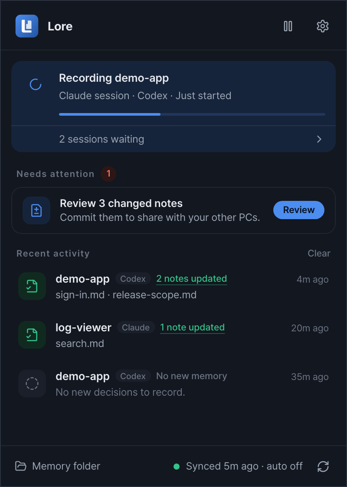
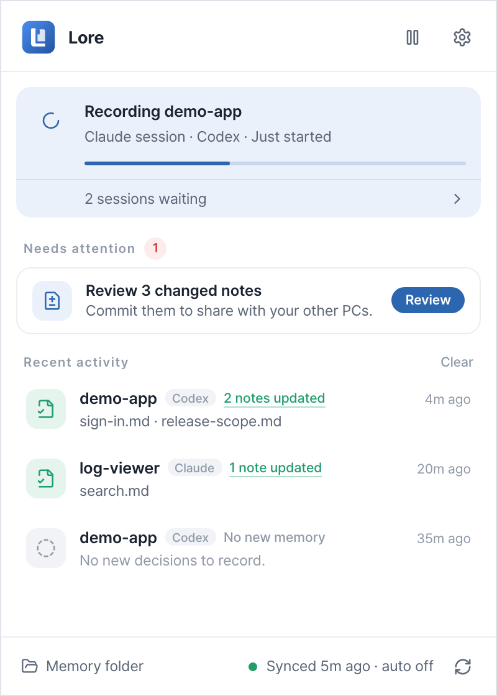
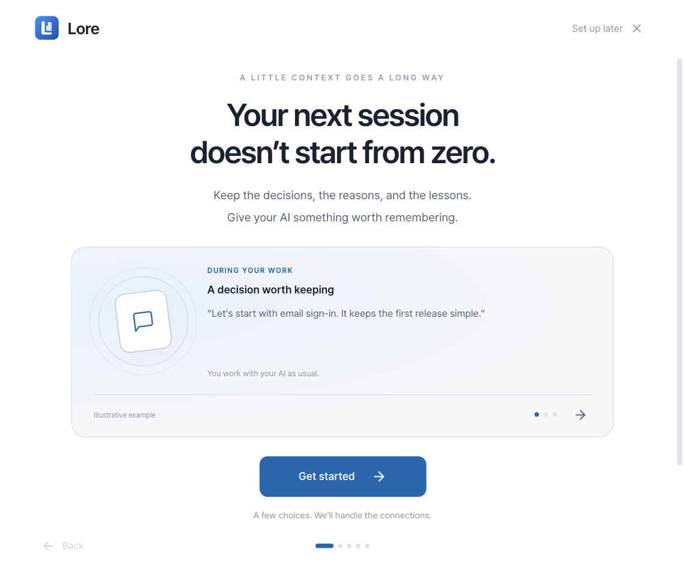
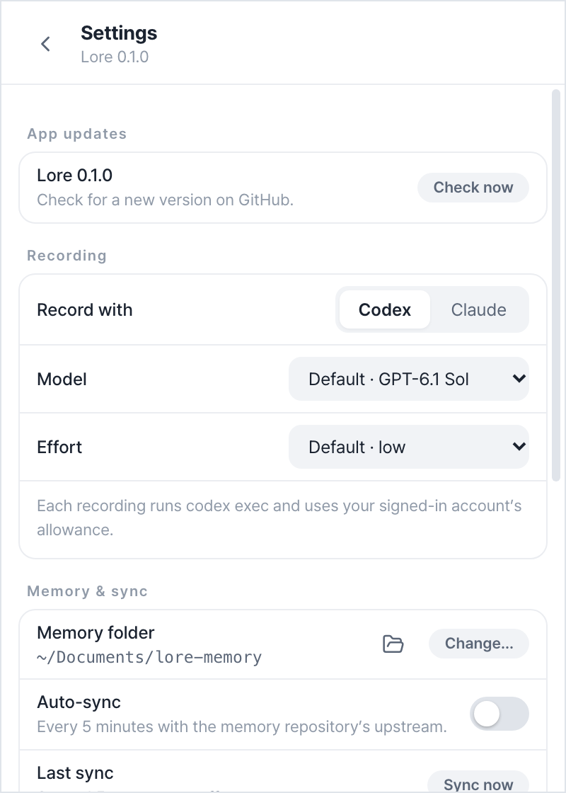
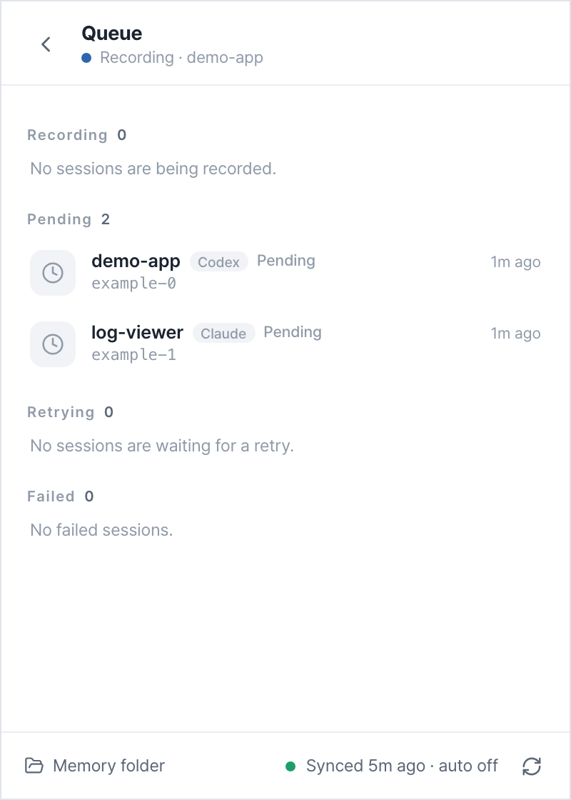
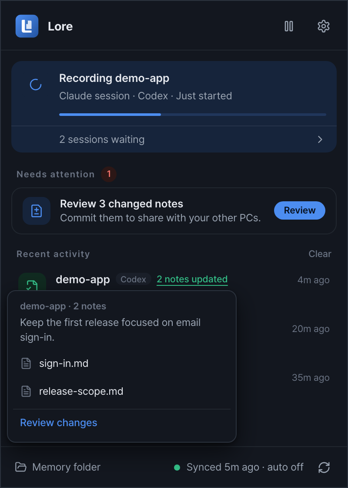
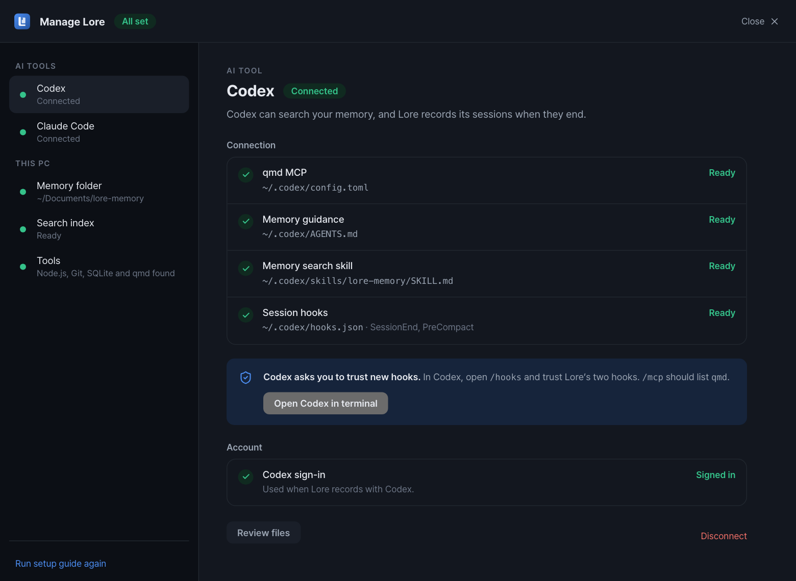
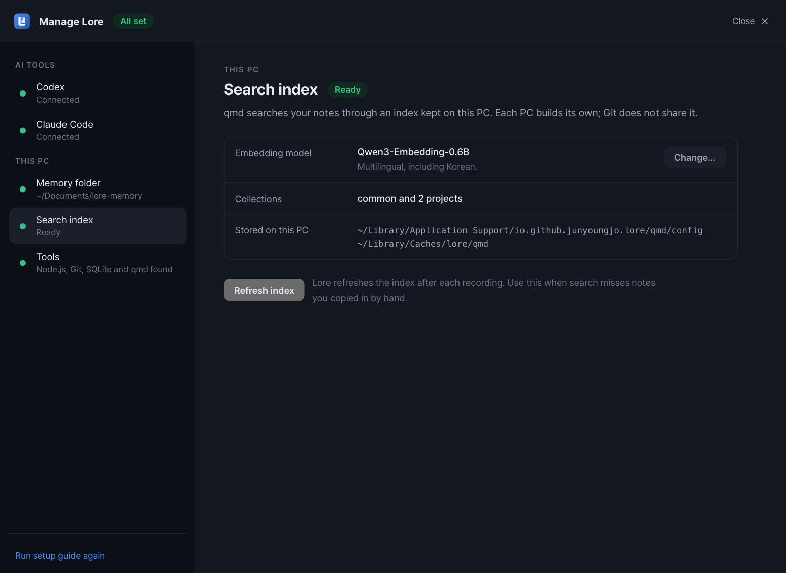

<div align="center">


# Lore — 코딩 에이전트를 위한 프로젝트 기억

**결정을 남기고, 이유를 기억하세요.**

Claude Code와 Codex의 결정·이유·해결 경험을 남기는 데스크톱 앱입니다.<br />
근거 대화와 변경 내용을 확인하고, 같은 Markdown 기억을 여러 도구와 PC에서 이어 씁니다.

[다운로드](https://github.com/JunYoungJo/lore/releases) · [시작하기](#시작하기) · [여러 PC에서 공유](#여러-pc에서-공유) · [문서](#문서) · [English](README.md)





<sub>실제 메인 트레이 화면의 다크·라이트 테마입니다. 시험용 데이터를 사용했으며 앱 UI는 영어입니다.</sub>

</div>

## 왜 Lore인가요?

“코드가 뭘 하는가”보다 “왜 이렇게 만들었는가”를 찾는 데 시간이 더 들 때가 있습니다. 새 세션의 에이전트는 파일을 읽을 수 있지만, 이전에 포기한 방법이나 결정을 바꾼 이유까지 알기는 어렵습니다.

Lore는 여러 코딩 도구와 PC를 오가며 프로젝트를 오래 이어 가는 개발자를 위한 앱입니다. 결정과 이유, 실패와 해결 경험을 **주제별 문서**로 남기고, 근거 대화와 Git 이력을 함께 보관합니다.

- **결정의 맥락을 남깁니다** — 기록 지침은 사용자 결정과 에이전트의 제안·보고를 구분하고, 적용 범위와 결정이 바뀐 이유를 보존하도록 합니다. 이 구분은 기록 모델의 판단에 달려 있으므로 근거 대화로 확인할 수 있게 합니다.
- **기억을 직접 확인할 수 있습니다** — 문서에서 근거 대화로 돌아가고, 변경을 나란히 비교하고, 커밋할 문서를 고릅니다. 기록은 자동이며, 로컬 변경 검토는 문서의 최초 반영 여부가 아닌 Git 커밋을 결정하는 단계입니다.
- **도구와 PC가 바뀌어도 이어 씁니다** — Claude Code와 Codex가 qmd MCP로 같은 기억을 찾습니다. Git으로 문서와 근거를 함께 옮기고, 양쪽 이력이 갈라지면 비교·선택·최종 미리보기 단계를 거쳐 공유합니다.

## 주요 기능

- **작업하면서 기록** — Claude Code·Codex의 세션 종료와 압축 직전 훅으로 대화를 큐에 넣습니다. 트레이 앱이 마지막 기록 위치부터 이어서 처리합니다.
- **주제별 기억** — 선택한 기록 모델이 프로젝트·공통 문서를 갱신합니다. 세션마다 별도의 보고서를 쌓는 방식이 아닙니다.
- **확인할 수 있는 근거** — 기억 문서에서 저장된 대화 사본과 발언 앵커로 이동합니다. 상대 링크라 문서와 근거를 다른 PC로 함께 옮길 수 있습니다.
- **Markdown과 검색** — 선택한 폴더에 문서를 보관하고 [qmd](https://github.com/tobi/qmd)로 색인합니다. 후속 에이전트는 qmd MCP로 관련 기억을 검색할 수 있습니다.
- **검토 후 커밋** — 마지막 커밋과 현재 내용을 나란히 비교하고 커밋할 문서를 고릅니다. 대화의 기억 문서 반영은 자동이며, 이 검토는 Git 커밋을 결정하는 단계입니다.
- **여러 PC의 충돌 검토** — 바뀐 노트, 근거와 선택지, 나란히 보는 최종 결과를 단계별로 확인합니다. Git 줄 충돌이 없어도 관련 기억을 비교하고, 확인 후 반영·공유합니다.
- **중단 후 복구** — 대기·실패 작업을 확인하고 다시 시도하거나 실패한 기록 구간을 넘길 수 있습니다. 동기화의 검색 갱신·전송 실패도 상태를 보존합니다.
- **트레이에서 작업 확인** — 현재 기록, 대기 세션, 최근 기억을 확인합니다. **Needs attention**에 연결 문제·검토할 노트·실패한 기록·공유하지 못한 기억을 모으고, 하단에서 동기화 상태를 확인하거나 동기화합니다. 최근 활동에서 바뀐 노트 목록을 열 수 있습니다.
- **바꾸면 적용되는 설정** — CLI가 제공하는 목록에서 기록 모델과 지원하는 effort를 고릅니다. 목록을 읽지 못하면 모델 이름을 직접 입력합니다. 시스템·라이트·다크 테마와 기록 한도를 설정할 수 있습니다.
- **연동 관리** — **Manage Lore**에서 AI 연결, 기억 폴더, 이 PC의 검색 색인과 도구를 따로 관리합니다. 파일·훅 상태를 확인해 연결을 복구·해제하고, 임베딩 모델을 바꾸기 전에 색인 재생성을 확인합니다.
- **첫 실행 안내** — 필요한 준비를 확인하고 내장 터미널에서 설치·로그인 명령을 실행해 AI 도구를 연결합니다. 연결 준비와 실제 기록·검색 확인을 구분하며, 이후 관리는 별도 창에서 진행합니다.
- **서명된 앱 업데이트** — 시작 시, 트레이 메뉴, **Settings → App updates**에서 새 버전을 확인합니다. 릴리즈 노트를 읽고 **Install & restart**를 선택합니다. 기록·동기화·검토·설정 작업을 마쳐야 설치할 수 있습니다.

<p align="center">
  
</p>

<details>
<summary>설정·세션 큐·바뀐 노트 목록</summary>





</details>

<details>
<summary>연결과 로컬 검색 관리</summary>




</details>

## 동작 흐름

```text
Claude Code / Codex의 세션 종료 또는 압축 직전
  → 훅이 원문 경로를 로컬 큐에 등록
  → 모델이 프로젝트·공통 문서의 변경안을 작성
  → Lore가 경로·인용문·근거 링크·수정 위치를 검사
  → 기억 문서와 대화 사본 저장, qmd 색인 갱신
  → 다음 세션에서 qmd MCP로 관련 기억 조회
```

무엇을 기억할지는 모델이 판단합니다. 프로그램의 검사는 잘못된 형식과 유효하지 않은 수정을 걸러내지만, 기억의 정확성을 증명하지는 않습니다. 후속 에이전트에도 qmd MCP와 기억을 찾아보라는 지침이 필요합니다. 기록만 켠다고 모든 세션이 기억을 자동 활용하는 것은 아닙니다.

## 시작하기

초기 개발 단계의 프로젝트입니다. [GitHub Releases](https://github.com/JunYoungJo/lore/releases)에서 설치 파일을 제공하며, 아래 방법으로 소스에서 빌드할 수도 있습니다.

### 설치

- **macOS:** Apple Silicon(`aarch64`) 또는 Intel(`x64`)용 DMG를 선택하고 Lore를 Applications로 옮긴 뒤 실행합니다.
- **Windows:** `x64-setup.exe` NSIS 설치본을 사용합니다.
- **Linux:** 앱 내 업데이트에는 AppImage를 사용합니다. DEB는 새 패키지를 설치해 갱신합니다.

현재 Apple Developer ID 서명·공증과 Windows 코드 서명 인증서는 적용하지 않아 운영체제 보안 경고가 나타날 수 있습니다. Tauri 업데이트 서명과 운영체제 코드 서명은 별개입니다. 설치 후 첫 실행 안내에서 코딩 도구와 기억 폴더를 준비합니다.

### 필요한 것

- 로그인된 Codex 또는 Claude CLI: 기록 모델 실행에 사용합니다.
- 이 PC에서 실행 가능한 [qmd](https://github.com/tobi/qmd): 색인과 검색에 사용합니다.
- 동기화에는 Git 2.38 이상과 기억 저장소의 remote·현재 브랜치 upstream이 필요합니다.
- 소스 빌드에는 stable Rust, Node.js 24, pnpm과 운영체제별 [Tauri 2 사전 준비](https://v2.tauri.app/start/prerequisites/)가 필요합니다.

모델 호출은 선택한 CLI의 인증과 사용 한도를 사용하며 제공자의 과금이 발생할 수 있습니다. 처리에 필요한 대화와 기억 문서는 해당 모델 제공자에게 전달됩니다.

### 빌드와 실행

이 저장소를 체크아웃한 폴더에서 실행합니다.

```sh
pnpm install --frozen-lockfile
pnpm tauri dev                  # 개발용 실행, 화면 변경 시 새로고침
pnpm tauri build                # 현재 운영체제의 앱 패키지 빌드
```

앱 실행 파일은 `lore`(Windows는 `lore.exe`), 훅 CLI는 `lore-cli`(Windows는 `lore-cli.exe`), 앱 식별자는 `io.github.junyoungjo.lore`입니다. CLI는 빌드·패키징에 함께 포함됩니다. 셸 PATH에 자동 등록되지는 않으므로 필요하면 전체 경로로 실행합니다. macOS 번들에서는 `Lore.app/Contents/MacOS/lore-cli`, Windows에서는 앱과 같은 폴더의 `lore-cli.exe`입니다.

### 기억 저장소 연결

1. 처음 실행하면 설정 안내가 열립니다. 기존 설치에서는 **Settings → Advanced → Run setup guide again**으로 엽니다.
2. 기억이 쓰이는 예시를 살펴보고 사용할 AI 도구를 선택합니다. 앱이 이 PC의 도구·로그인을 확인하며, 부족한 설치·로그인 작업에만 터미널을 엽니다.
3. 기존 기억 폴더를 선택하거나, 빈 폴더에 새 Git 저장소를 만들거나, 기억 remote를 clone합니다. 기본 위치는 기존과 같은 `~/Documents/lore-memory`입니다.
4. **What will change?**에서 변경 범위를 확인하고 **Connect & prepare memory**를 누릅니다. 로컬 색인과 qmd MCP·짧은 메모리 지침·검색 스킬·세션 훅을 준비하며 기존 사용자 지침은 보존합니다.
5. AI 도구를 다시 시작하고, Codex의 `/hooks`에서 Lore 훅을 신뢰로 표시합니다. `/mcp`에서 `qmd` 연결을 확인합니다. 앱이 신뢰 승인을 대신하지는 않습니다.
6. 새 색인은 한국어를 지원하는 Qwen3-Embedding-0.6B를 쓰고 기존 모델은 유지합니다. **Manage Lore → Search index**에서 embeddinggemma-300M으로 바꾸거나 되돌릴 수 있고, 바꾸면 그 PC의 색인을 다시 만듭니다. 준비가 끝나면 바로 사용을 시작할 수 있습니다.
7. 일반 Git 프로젝트 세션에서 첫 기억을 기록하고 새 세션에서 찾아보십시오. 외부 세션의 실험은 설정 완료를 막지 않습니다. 앱은 연결 준비와 실제 기록·검색 확인을 구분합니다.

**Set up later**로 진행 위치를 저장하고 나중에 이어갈 수 있습니다. **Settings → Connections → Manage connections**로 별도의 **Manage Lore** 창을 엽니다. 클라이언트별 MCP·지침·검색 스킬·훅 상태를 확인하고, 기억 폴더·색인·필요한 도구는 각각의 페이지에서 관리합니다. 보존 범위·플랫폼별 설치 제한은 [설정 안내](docs/setup.md)에 있습니다. 수동으로 확인하려면 `lore-cli doctor`, 앱을 종료한 상태에서 색인하려면 `lore-cli index`를 사용합니다.

**Settings → Recording**의 모델·effort 선택지는 로그인한 CLI가 제공하는 목록을 따릅니다. 목록을 읽지 못하면 모델 이름을 직접 입력할 수 있습니다. 설정은 바꾸면 적용되고, 글자 칸은 포커스를 옮기거나 Enter를 누르면 저장합니다. **General → Appearance**에서 System·Light·Dark를 고릅니다. 기록 모델은 기억을 작성하고, qmd는 색인과 검색을 맡습니다. 검색용 임베딩 모델은 **Manage Lore → Search index**에서 별도로 관리합니다.

앱이 꺼져 있어도 훅은 큐에 등록하며, 앱을 다시 켜면 처리합니다. 훅이 실행되지 않은 세션은 자동으로 찾지 않습니다. 필요하면 `lore-cli scan`으로 직접 큐에 넣습니다.

다른 PC의 기존 기억 문서를 가져올 때는 먼저 [이전 안내](docs/multiplatform.md#기존-windows-기억-가져오기)를 따릅니다.

## 여러 PC에서 공유

각 PC에 같은 **기억 Git 저장소**를 clone하고 앱에 그 PC의 경로를 지정합니다. 소스 프로젝트의 체크아웃 이름이 다르면 [고정 프로젝트 ID](docs/multiplatform.md#고정-프로젝트-id)를 사용합니다.

1. **Needs attention → Review**에서 바뀐 노트를 비교하고 커밋합니다. 미커밋 파일은 동기화 전에 처리해야 합니다.
2. 하단 동기화 버튼이나 **Settings → Memory & sync → Sync now**를 누릅니다. 한쪽에만 새 커밋이 있으면 가져오기·전송과 이 PC의 검색 갱신을 처리합니다.
3. 양쪽 이력이 갈라지면 상태 카드에서 검토 창을 엽니다. 바뀐 노트와 원문 차이를 확인하고 **Compare with model**을 누릅니다. 같은 프로젝트나 공통 기억은 Git 줄 충돌이 없어도 비교합니다.
4. 왼쪽의 결정할 항목을 하나씩 열어 근거 발언과 선택지를 확인합니다. 아래 고정 바에서 결정한 항목 수를 확인할 수 있습니다.
5. **Check result**로 **This PC now / After applying**를 나란히 비교하고 **Apply & share**로 반영합니다. 앱이 병합 커밋·검색 갱신·push를 처리하며 강제 push는 하지 않습니다.


**선택지를 고르면 처리할 수 있고, 문서를 직접 수정하는 것은 선택 사항입니다.** 5분마다 자동 동기화는 기본 꺼짐입니다. 켜면 커밋된 이력을 확인하고, 검토가 필요할 때 새 기억 기록을 대기시킵니다. 모델 비교와 최종 반영은 직접 진행합니다. 미커밋 문서를 자동 커밋하거나 stash하지 않습니다.

<details>
<summary>최종 문서 미리보기 화면</summary>


</details>

나중에 처리하기, 실패 후 재개, 지원하지 않는 충돌은 [동기화 검토 안내](docs/sync-review.md)에 설명했습니다. 모델이 의미 충돌을 놓칠 수 있으므로 근거와 최종 문구를 확인해야 합니다.

## 데이터와 공유 범위

```text
lore-memory/
├── common/                  # 공통 기억
├── projects/<project-id>/   # 프로젝트별 기억
└── sources/<provider>/      # 근거 대화 사본
```

큐·설정·모델 실행 자료·qmd 색인은 PC별 앱 데이터에 두며 기억 폴더와 분리합니다. 새 근거 링크는 문서 기준 상대 경로와 원본 발언 앵커를 사용합니다.

Git으로는 **기억 저장소에 커밋한 모든 파일**이 공유됩니다. 대화 사본에는 인용한 문장 외의 내용도 들어 있을 수 있으므로 저장소의 공개 범위와 내용을 확인해야 합니다. 모델 처리에 필요한 대화와 문맥은 선택한 CLI의 제공자에게 전달됩니다. 전체 기능이 오프라인으로 동작하는 앱은 아닙니다.

## 플랫폼별 확인 상태

| 운영체제 | 빌드 구성 | 이 브랜치에서 확인한 범위 |
| --- | --- | --- |
| macOS | app / dmg | 11월 10일 Apple Silicon app 빌드·격리 기동 확인. 서명·공증 미확인 |
| Windows | NSIS 설치본 | 11월 11일 릴리스 실행 파일·설치본 빌드. 자동 검사와 기존 Windows 테스트 실패는 VALIDATION.md에 기록 |
| Linux | deb / AppImage | 플랫폼 코드와 CI 구성. 실제 데스크톱 실행 미확인 |

빌드와 자동 검사만으로 모든 운영체제의 훅·알림·데스크톱 연동을 확인한 것은 아닙니다. 최신 UI 캡처는 프런트엔드 예제 응답으로 렌더링했습니다. 자세한 결과와 한계는 [VALIDATION.md](VALIDATION.md)에 있습니다.

## 개발과 검증

```sh
pnpm build:cli                     # 새 체크아웃에서 Rust 검사 전에 필요
cargo test --workspace --locked
pnpm test
pnpm typecheck
```

자동 테스트는 고정 입력과 임시 저장소를 사용하며 실제 모델·qmd를 호출하지 않습니다. 별도 평가를 실행하면 실제 모델을 호출하고 사용량이 발생합니다.

```sh
node scripts/evaluate-memory.mjs --backend codex
node scripts/evaluate-sync.mjs --backend codex
```

두 평가는 qmd를 색인 대체 구현으로 바꿔 실행합니다. 모델 출력과 프로그램 동작을 확인하는 평가이며 실제 검색 품질이나 장기 효용의 검증은 아닙니다.

| 경로 | 역할 |
| --- | --- |
| `crates/core/` | 원문 해석, 기록, 검사, 큐, qmd 연동, Git 동기화 |
| `crates/cli/` | 훅 접수, 진단, 수동 처리와 복구 |
| `src-tauri/` | 앱 실행, 트레이, 창, 알림, 백그라운드 처리 |
| `src/` | React·TypeScript 화면 |
| `scripts/` | 빌드 도구와 실제 모델 평가 |

## 문서

- [상세 사용법과 CLI](docs/usage.md)
- [여러 PC 설정·경로·기억 이전](docs/multiplatform.md)
- [동기화 검토와 복구](docs/sync-review.md)
- [검증 결과](VALIDATION.md)
- [데스크톱 릴리즈와 앱 업데이트](docs/releasing.md) — 영어
- [분리 경위와 이전 결정](docs/origin-and-scope.md) — 당시의 기록

## 라이선스

배포 라이선스는 아직 정하지 않았습니다. 현재 Rust workspace의 표기는 `UNLICENSED`입니다.
