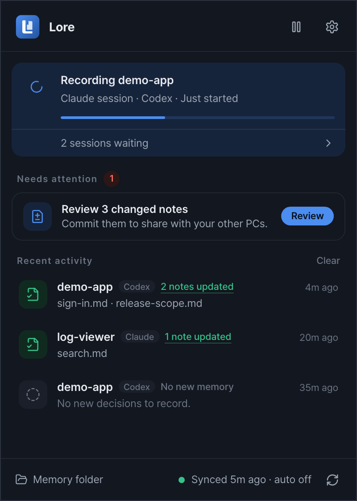
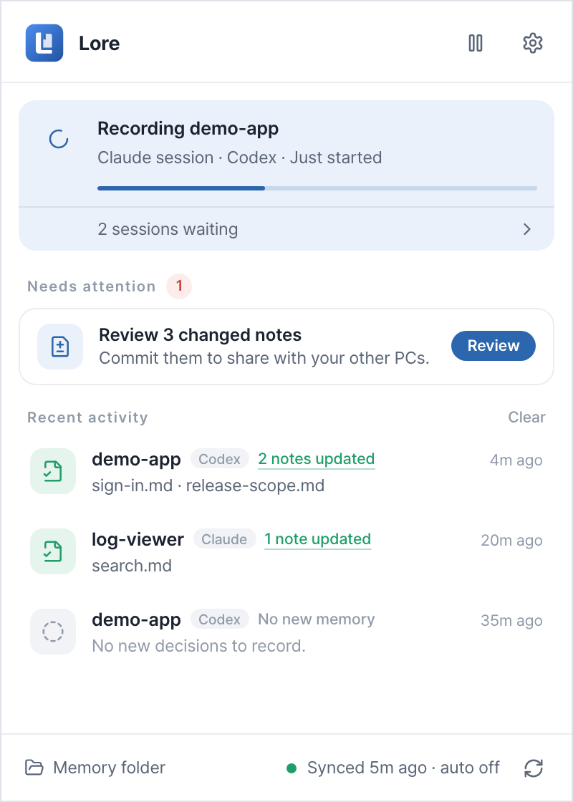
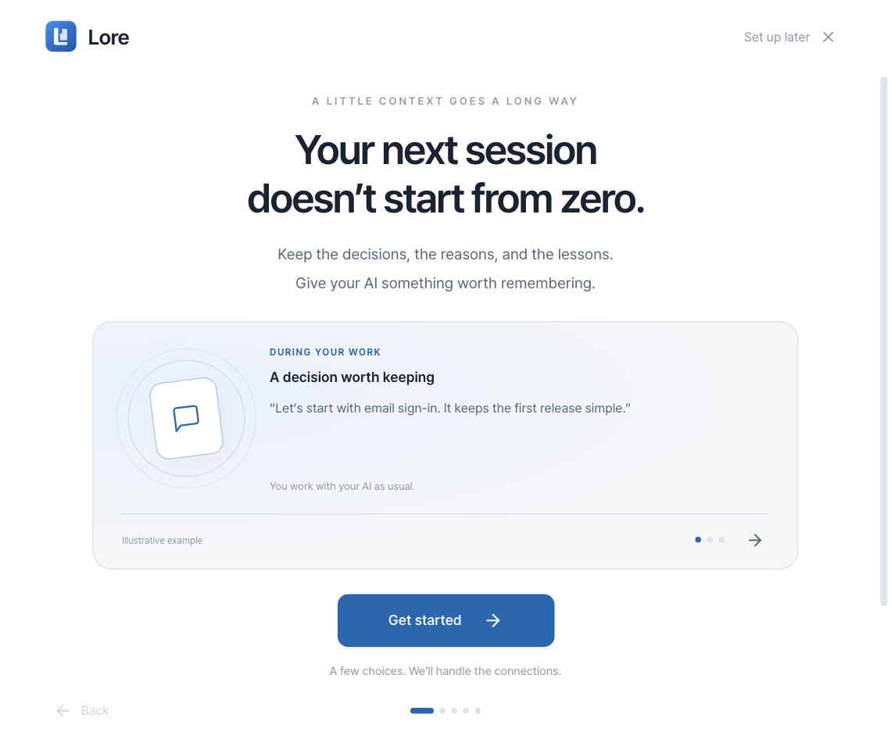
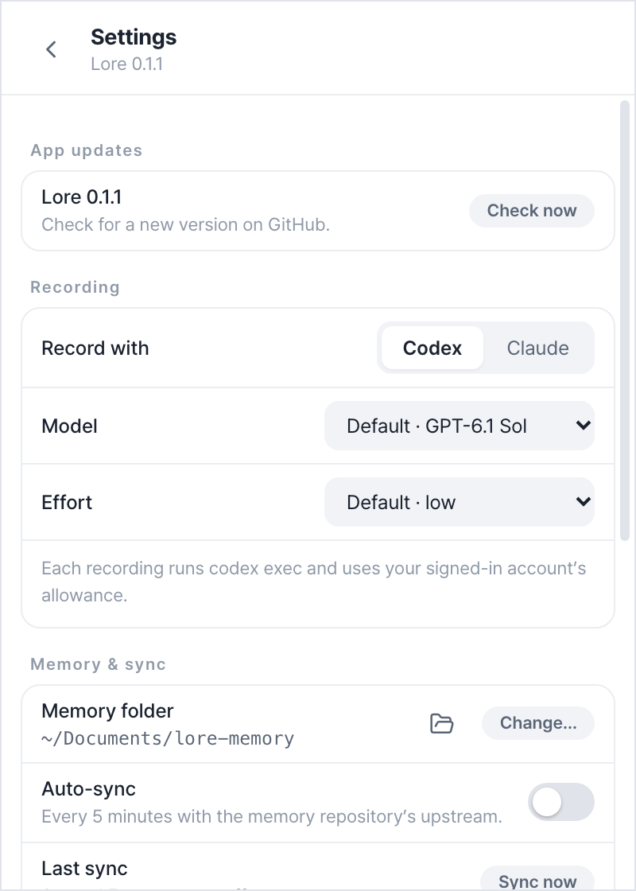
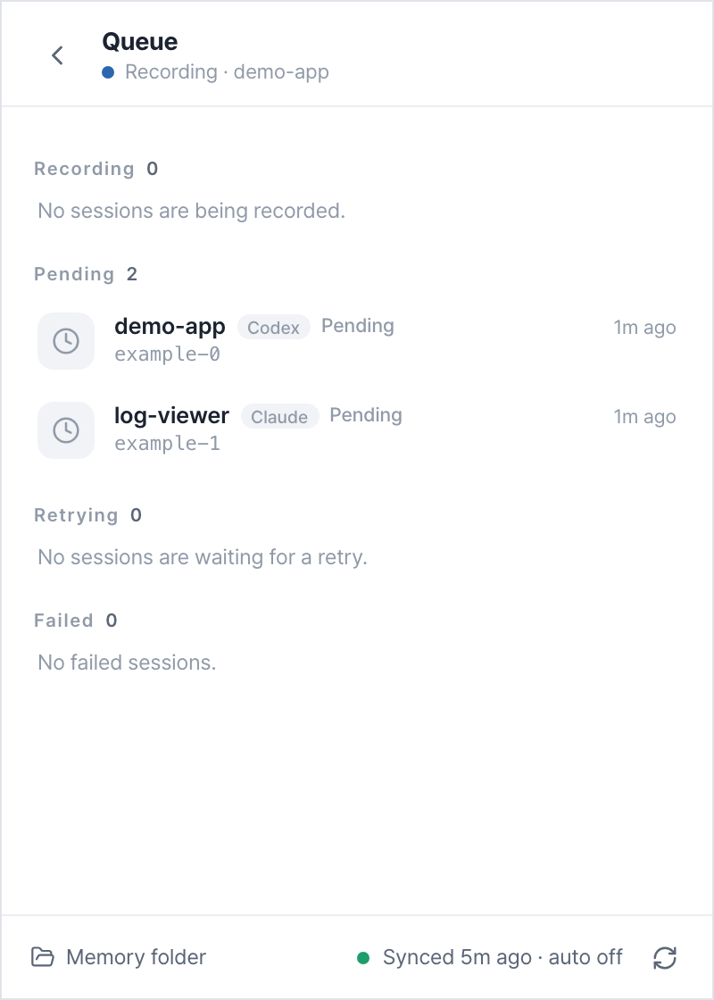
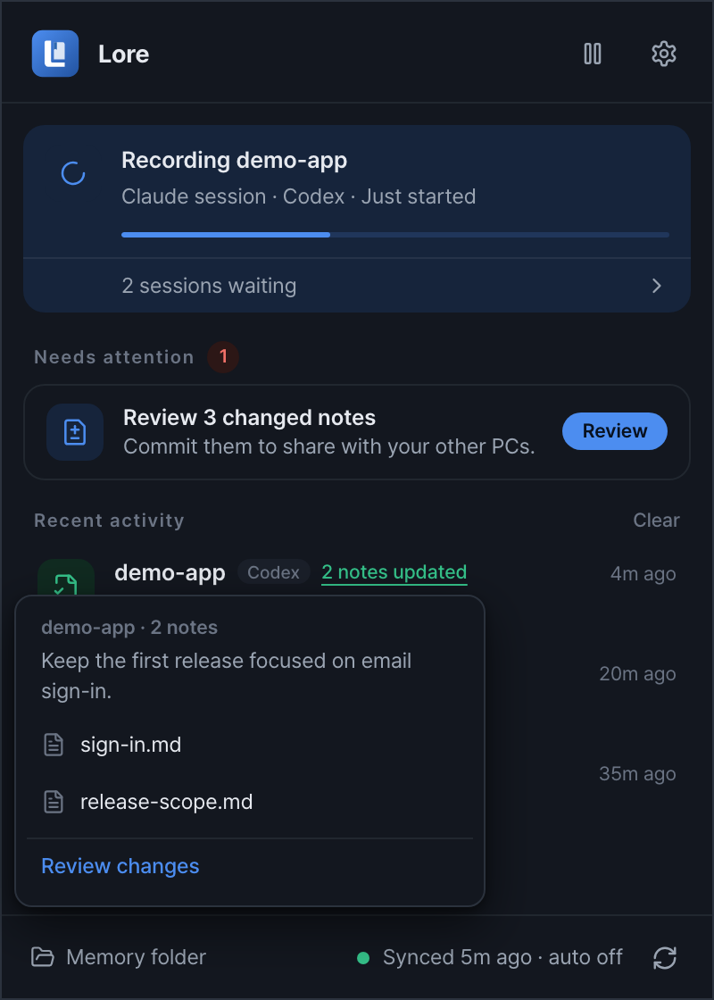
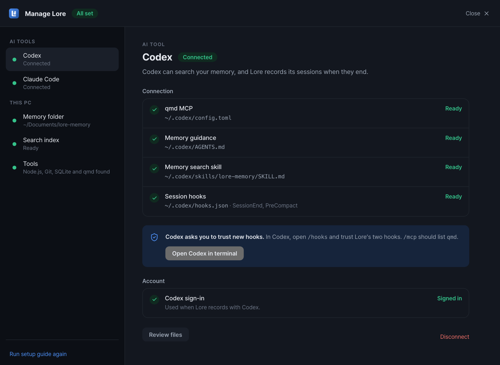
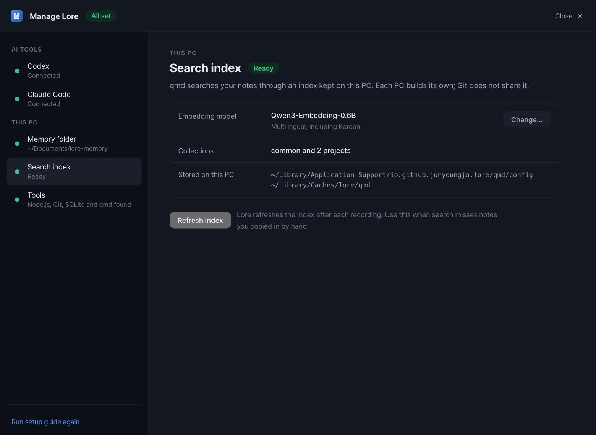
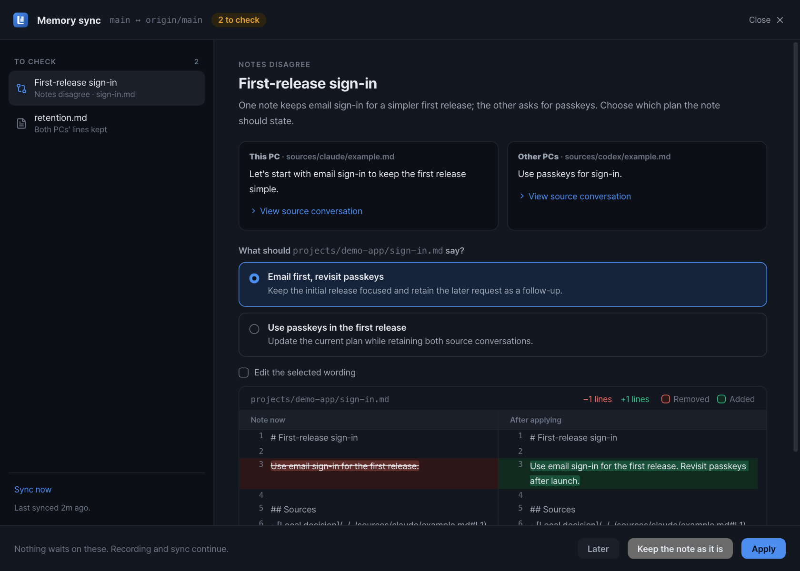
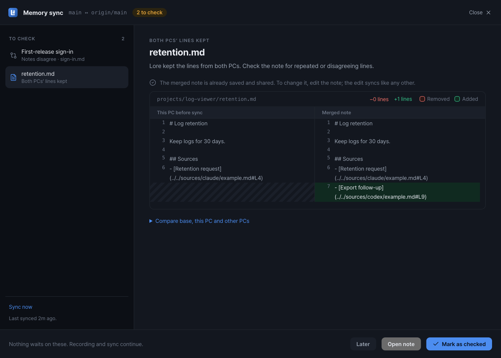

<div align="center">


# Lore — Project Memory for Coding Agents

**Keep the decisions. Remember the reasons.**

A desktop app for keeping decisions, reasons, and lessons from Claude Code and Codex.<br />
Follow the sources, review the changes, and carry the same Markdown memory between tools and PCs.

[Downloads](https://github.com/JunYoungJo/lore/releases) · [Get started](#getting-started) · [Sync across PCs](#sync-across-pcs) · [Documentation](#documentation) · [한국어](README.ko.md)





<sub>The main tray window in dark and light themes. Screenshots use synthetic example data; the UI is in English.</sub>

</div>

## Why Lore?

“Why did we choose this?” often takes longer to answer than “What does the code do?” A new coding session may have the files but miss the rejected approach, the constraint behind a decision, or the reason yesterday's plan changed.

Lore is built for developers who work across coding tools, long-running projects, or multiple PCs. It preserves that context as topic-based notes, with the supporting conversations and Git history alongside them.

- **Decisions with their context** — Recording instructions distinguish user decisions from agent proposals and reports, retain their scope, and preserve earlier reasons when a decision changes. These distinctions depend on the recording model; the source remains available to check.
- **Memory you can inspect** — Follow a note back to the conversation, compare changes side by side, and choose which notes to commit. Recording is automatic; reviewing local changes controls the Git commit, not whether a note is initially written.
- **Continuity across tools and PCs** — Claude Code and Codex can search the same notes through qmd MCP. Git carries the notes and their evidence between PCs; diverged histories have a separate comparison, decision, and final-preview workflow.

## Features

- **Capture as you work** — Claude Code and Codex hooks enqueue conversations at session end and before compaction. The tray app processes them in the background, resuming from the last recorded position.
- **Notes organized by topic** — A configured coding model updates project and shared knowledge instead of creating a report for every session.
- **Checkable sources** — Relative links point to saved conversation copies and stable turn anchors, so evidence can travel with the notes.
- **Local Markdown, searchable context** — Notes live in a folder you choose. [qmd](https://github.com/tobi/qmd) indexes them for search and retrieval through its MCP server.
- **Review before committing** — Compare local changes side by side and choose which notes to commit. Conversation recording itself writes notes automatically; this review controls the Git commit.
- **Git sharing with conflict review** — Move through changed notes, evidence-backed choices, and a side-by-side final result. Compare related changes even when Git reports no line conflict, then confirm before applying and sharing.
- **Recoverable background work** — View pending and failed jobs, retry them, or skip a failed recording segment. A failed sync is retried in the background without holding recording.
- **A tray view of the work** — See the current recording, waiting sessions, and recent notes. **Needs attention** collects connection problems, notes to review, failed recordings, and unshared memory; the footer shows sync status and a sync action. Open updated notes from an activity row.
- **Settings that apply as you change them** — Select a recording model and its supported effort from the CLI's list, or enter a model name when a list is unavailable. Choose a system, light, or dark appearance and configure recording limits.
- **Connection management** — **Manage Lore** separates AI connections, the memory folder, this PC's search index, and required tools. Inspect each managed file and hook, repair or disconnect a client, and change the embedding model with an explicit index rebuild.
- **Guided setup** — Check dependencies, run prepared commands in an embedded terminal, and connect AI clients. Setup readiness and successful recording/recall are shown separately; ongoing management has its own window.
- **Signed app updates** — Check at startup, from the tray menu, or under **Settings → App updates**. Inspect the release notes and choose **Install & restart**. Recording, sync, review, and setup work must finish before installation.

<p align="center">
  
</p>

The first-run introduction. Ongoing repair and removal have a separate integration-management window.

<details>
<summary>Settings, session queue, and updated notes</summary>





</details>

<details>
<summary>Manage connections and local search</summary>




</details>

## How it works

```text
Claude Code / Codex session ends or reaches compaction
  → Hook adds the transcript to a local queue
  → Model proposes changes to project and shared notes
  → Lore validates paths, quotations, source links, and edit locations
  → Notes and conversation copies are saved; qmd refreshes its index
  → A later session can find relevant context through qmd MCP
```

The model decides what is worth recording. Program checks catch malformed output and invalid edits; they do not prove that a memory is correct. Future agents also need qmd MCP and instructions to consult project memory—recording alone does not make every session use it.

## Getting started

Lore is an early-stage project. Installers are published through [GitHub Releases](https://github.com/JunYoungJo/lore/releases); source builds are described below.

### Install

- **macOS:** choose the Apple Silicon (`aarch64`) or Intel (`x64`) DMG, then move Lore to Applications before running it.
- **Windows:** use the `x64-setup.exe` NSIS installer.
- **Linux:** use the AppImage for in-app updates, or install the DEB and update it with a newer package.

macOS builds use ad-hoc signing, without Apple Developer ID or notarization. macOS may still block opening the app; if offered, use **System Settings → Privacy & Security → Open Anyway** after attempting to open it. Windows builds have no code-signing certificate. The Tauri update signature is separate from OS code signing. Open the first-run guide to prepare your coding tools and memory folder after installation.

### Requirements

- An authenticated Codex or Claude CLI for the recording model.
- [qmd](https://github.com/tobi/qmd) installed and usable on this PC for indexing and search.
- Git 2.38+ for the synchronization workflow, plus a remote and branch upstream when sharing between PCs.
- For building: stable Rust, Node.js 24, pnpm, and the [Tauri 2 prerequisites](https://v2.tauri.app/start/prerequisites/) for your OS.

Model calls use the authentication and usage limits of the CLI that runs: the first one under **Settings → Recording**, or the second one when it is turned on and the first cannot run. They may incur provider charges. Conversations and relevant notes are sent to that provider for processing.

### Build and run

From a checkout of this repository:

```sh
pnpm install --frozen-lockfile
pnpm tauri dev                 # Development app with frontend hot reload
pnpm tauri build               # Desktop bundle for the current platform
```

The build includes `lore-cli` as a sidecar. The app executable is `lore` (`lore.exe` on Windows), and its application identifier is `io.github.junyoungjo.lore`. The CLI is not automatically added to your shell’s PATH; use its full path when needed. In a macOS bundle it is `Lore.app/Contents/MacOS/lore-cli`; on Windows it is `lore-cli.exe` beside the app.

### Set up your memory

1. Open the first-run introduction, or use **Settings → Advanced → Run setup guide again** on an existing installation. Try the short memory example, then choose your coding tools and memory folder.
2. Lore checks the tools and sign-in needed on this PC. Only missing setup is offered. When needed, review a prepared command and select **Run** in the embedded terminal.
3. Choose an existing memory folder, create a new Git repository, or clone your memory remote. The default location is still `~/Documents/lore-memory`.
4. In preparation, inspect **What will change?** and select **Connect & prepare memory**. Lore prepares search and connects the selected clients through qmd MCP, memory guidance, a search skill, and session hooks. Existing user instructions and unrelated settings are preserved.
5. Restart your AI client. In Codex, review and trust Lore's hooks through `/hooks`; check the `qmd` server in `/mcp`. Lore does not grant trust on your behalf.
6. New indexes use Qwen3-Embedding-0.6B for multilingual search. Existing model choices are preserved; **Manage Lore → Search index** can switch to embeddinggemma-300M and back, rebuilding the index on that PC. The guide shows when preparation is complete.
7. Start using Lore. For your first memory, make a decision in a normal Git-project session and recall it through qmd in a new session. This exercise can happen after setup; configuration readiness is not presented as proof of successful recording and recall.

Use **Set up later** to save your place. Open **Settings → Connections → Manage connections** for the separate **Manage Lore** window. It shows each client's MCP, guidance, search skill, and hooks with their current state; memory-folder, index, and tool controls are separate pages. See [Setup and integrations](docs/setup.md) for ownership, platform details, and limitations.

In **Settings → Recording**, model and effort choices come from the signed-in CLI's reported list. If it cannot be read, the model field falls back to text entry. Settings apply immediately; text fields save on blur or Enter. **General → Appearance** offers System, Light, and Dark. The recording model writes notes; qmd handles indexing and search, using an embedding model configured separately under **Manage Lore → Search index**.

For manual setup, the bundled `lore-cli doctor` reports this PC's command and index paths. Run `lore-cli index` with the tray app closed to initialize or refresh the index outside the guide.

Hooks can enqueue work while the app is closed. The app processes that queue when it starts again. Sessions whose hooks never ran are not automatically scanned; `lore-cli scan` is available for manual recovery.

To bring existing memory documents from another PC, follow the [portability guide](docs/multiplatform.md#importing-existing-windows-memory) before recording on another PC.

## Sync across PCs

Clone the same **memory repository** on each PC and set each app's memory folder to its local checkout. Give source projects a stable [project ID](docs/multiplatform.md#stable-project-id) when checkout names differ.

Turn on **Settings → Memory & sync → Auto-sync**. From then on sync needs no action from you:

1. When a recording finishes, Lore commits the notes it wrote.
2. It fetches the other PCs' commits and merges them. Notes changed on different PCs, or in different places of the same note, are simply combined.
3. Where both PCs changed the same lines, Lore keeps the lines from both and lists the note under **to check**.
4. It refreshes this PC's search index and pushes, without force. If another PC pushed first, it merges again and retries.

Recording never waits for sync. A failed sync is retried on the next cycle and reported only after it fails three times in a row. **Auto-sync is off by default**; with it off, notes are still committed after each recording and shared when you choose **Sync now**.

After a sync, Lore asks the recording model to compare only the notes that both PCs changed. Disagreements it finds are added to the same list, with the quoted sources and a few wordings to choose from. Notes are already merged and shared at that point, so you can look at the list whenever you want, or not at all.



<details>
<summary>See a note where both PCs' lines were kept</summary>



</details>

Reviewing notes is separate and optional: **Review** in **Needs attention** shows what was recorded on this PC since your last review. See the [sync guide](docs/sync-review.md) for failures, retries, and the CLI. The model can miss contradictions; check its evidence and proposed wording.

## Data and privacy

```text
lore-memory/
├── common/                  # Shared notes
├── projects/<project-id>/   # Project notes
└── sources/<provider>/      # Conversation copies referenced by notes
```

The queue, settings, model execution records, and qmd indexes stay in per-PC app data. They are separate from the memory folder. New evidence links are relative to the note and use source-turn anchors.

Git sharing sends **all committed files in the memory repository**. Conversation copies can contain more than the quoted sentences. Choose the repository's visibility and contents accordingly. Lore's model processing is not fully offline: the configured coding CLI receives the conversations and context used for each request.

## Platform status

| Platform | Build configuration | Verification on this branch |
| --- | --- | --- |
| macOS | App / DMG | Release CI checks ad-hoc app/CLI signatures for both architectures; Developer ID and notarization are not configured |
| Windows | NSIS installer | Nov 11 release executable and installer built |
| Linux | DEB / AppImage | Platform code and CI configured; desktop runtime not checked |

Build and automated-test results do not establish that every hook, notification, or desktop integration works on every OS. The latest UI screenshots use frontend fixtures. Native installation and upgrade flows still need platform-specific checks.

## Development

```sh
pnpm build:cli                    # Required before Rust tests on a fresh checkout
cargo test --workspace --locked
pnpm test
pnpm typecheck
```

Automated tests use fixtures and temporary repositories without calling real models or qmd. Separate opt-in evaluations call the configured model and incur usage:

```sh
node scripts/evaluate-memory.mjs --backend codex
node scripts/evaluate-sync.mjs --backend codex
```

Both evaluations substitute an indexing fixture for qmd. They test model output and application behavior, not real search quality or long-term usefulness.

| Path | Responsibility |
| --- | --- |
| `crates/core/` | Transcript parsing, recording, validation, queue, qmd integration, Git synchronization |
| `crates/cli/` | Hook receiver, diagnostics, manual processing and recovery |
| `src-tauri/` | Desktop runtime, tray, windows, notifications, background processing |
| `src/` | React and TypeScript UI |
| `scripts/` | Build helpers and model evaluations |

## Documentation

- [한국어 소개와 시작하기](README.ko.md)
- [Detailed usage and CLI reference](docs/usage.md)
- [Multiple PCs, platform paths, and migration](docs/multiplatform.md)
- [Synchronization and notes to check](docs/sync-review.md)
- [Desktop releases and app updates](docs/releasing.md)

## License

A distribution license has not been selected. The Rust workspace is currently marked `UNLICENSED`.
